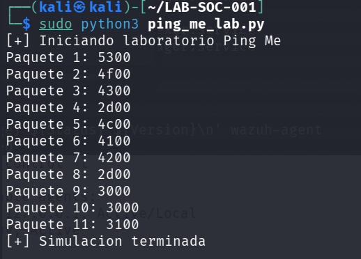
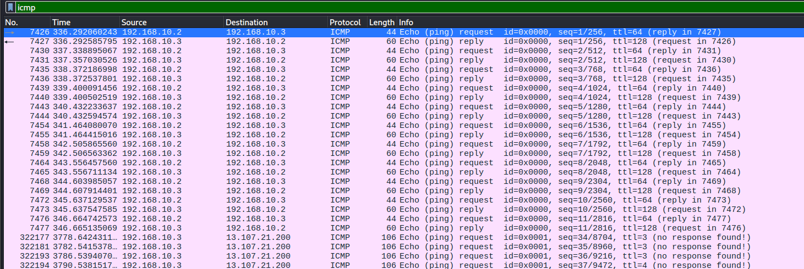
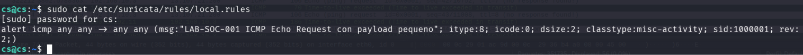
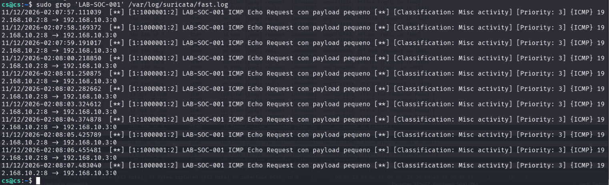
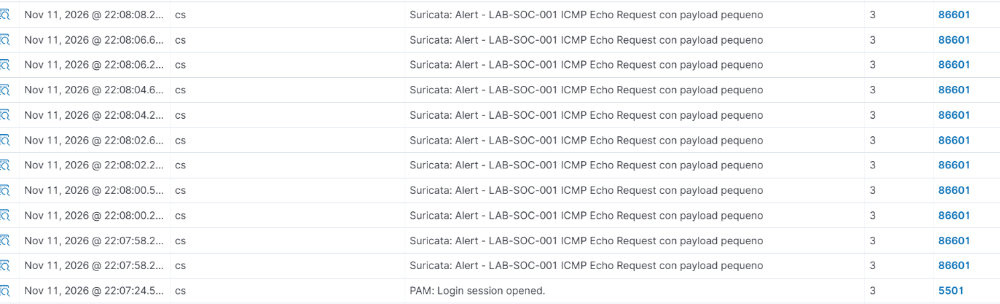
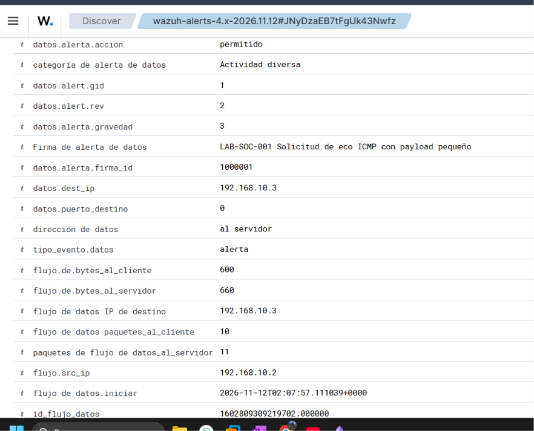

# LAB-SOC-001: Ping Me

**Área:** Blue Team / SOC  
**Categoría:** Detección y análisis de tráfico ICMP  
**Entorno:** VMware — Red virtualizada de laboratorio  
**Estado:** 🟢 Completado y verificado

---

## 1. Introducción

El laboratorio **LAB-SOC-001: Ping Me** tiene como objetivo simular y detectar tráfico ICMP mediante herramientas de monitorización de red y seguridad.

Desde Kali Linux se genera tráfico ICMP controlado hacia Windows 10 utilizando Python y Scapy. Los paquetes se analizan con Wireshark y Suricata IDS, mientras que Wazuh centraliza las alertas para su investigación desde Threat Hunting.

La actividad se realiza en un entorno autorizado y aislado, sin exfiltración real de información.

## 2. Objetivos

**Objetivo general:** Implementar y validar la detección de tráfico ICMP mediante Suricata IDS y Wazuh SIEM.

**Objetivos específicos:**

- Generar tráfico ICMP mediante Python y Scapy.
- Capturar y analizar los paquetes con Wireshark.
- Configurar una regla personalizada de detección en Suricata.
- Integrar las alertas de Suricata con Wazuh.
- Visualizar e investigar los eventos desde Threat Hunting.

## 3. Alcance del laboratorio

La práctica se desarrolla en una red virtualizada `192.168.10.0/24`, utilizando tres máquinas autorizadas.

El alcance comprende la generación, captura, detección y análisis de tráfico ICMP. No incluye explotación de vulnerabilidades ni extracción de información confidencial.

La regla implementada detecta un patrón específico de tráfico y no confirma, por sí sola, actividad maliciosa.

## 4. Topología de red

| Equipo | Dirección IP | Función |
|---|---|---|
| Kali Linux | `192.168.10.2` | Generación de tráfico ICMP |
| Windows 10 Pro | `192.168.10.3` | Equipo de destino y agente Wazuh `001` |
| Ubuntu Server 24.04.5 | `192.168.10.100` | Suricata IDS y servidor Wazuh |

**Flujo de detección:**

1. Kali genera solicitudes ICMP Echo Request hacia Windows.
2. Suricata inspecciona el tráfico observado en la interfaz `ens33`.
3. Las coincidencias con la regla personalizada generan alertas.
4. Wazuh Manager procesa los eventos registrados en `/var/log/suricata/eve.json`.
5. Las alertas se consultan desde Wazuh Dashboard.

Las alertas aparecen asociadas al ID `000`, correspondiente al Manager de Ubuntu, porque allí se procesan los registros de Suricata.

## 5. Herramientas utilizadas

| Herramienta | Función |
|---|---|
| VMware | Virtualización del laboratorio |
| Kali Linux | Equipo generador de tráfico |
| Windows 10 Pro | Equipo de destino |
| Ubuntu Server | Servidor de monitorización |
| Python y Scapy | Generación de paquetes ICMP |
| Wireshark | Captura y análisis del tráfico |
| tcpdump | Verificación del tráfico en Ubuntu |
| Suricata IDS 7.0.3 | Detección mediante reglas |
| Wazuh 4.14.9 | Centralización y análisis de alertas |

## 6. Generación del tráfico ICMP

### 6.1. Procedimiento

Desde Kali Linux (`192.168.10.2`) se ejecutó el script `ping_me_lab.py`, desarrollado con Python y Scapy, para generar 11 solicitudes ICMP Echo Request hacia Windows 10 (`192.168.10.3`).

Cada solicitud contenía un payload de dos bytes: un carácter ASCII de la cadena de prueba `SOC-LAB-001` y un byte nulo (`0x00`).

**Comandos ejecutados:**

```bash
cd ~/LAB-SOC-001
sudo python3 ping_me_lab.py
```

**Script original:** [ping_me_lab.py](analysis/ping_me_lab.py)

### 6.2. Evidencia de ejecución

La siguiente captura muestra la ejecución del script desde Kali Linux y los paquetes ICMP generados durante la simulación.



### 6.3. Resultado

Se generaron 11 solicitudes ICMP Echo Request dirigidas a Windows 10, con un payload de dos bytes por paquete.

---

## 7. Captura y análisis del tráfico ICMP

### 7.1. Procedimiento

Se utilizó Wireshark para analizar el tráfico ICMP generado desde Kali Linux (`192.168.10.2`) hacia Windows 10 (`192.168.10.3`).

**Filtro utilizado:**

```text
icmp.type == 8 && ip.src == 192.168.10.2 && ip.dst == 192.168.10.3
```

### 7.2. Evidencia del tráfico capturado



### 7.3. Análisis y resultado

La captura permitió identificar:

- **Protocolo:** ICMP.
- **Origen:** `192.168.10.2`.
- **Destino:** `192.168.10.3`.
- **Tipo ICMP:** `8` (Echo Request).
- **Solicitudes generadas:** 11.
- **Payload:** 2 bytes por solicitud.

Se verificó que los paquetes presentaban el patrón esperado para evaluar la regla personalizada de Suricata.

**Archivo de evidencia:** [LAB-SOC-001-trafico-icmp.pcapng](analysis/trafico.pcapng)

---

## 8. Detección de tráfico ICMP con Suricata IDS

### 8.1. Configuración de la regla

En Ubuntu Server se configuró una regla personalizada en `/etc/suricata/rules/local.rules` para detectar solicitudes ICMP Echo Request con un payload de exactamente dos bytes.

**Regla implementada:**

```text
alert icmp any any -> any any (msg:"LAB-SOC-001 ICMP Echo Request con payload pequeno"; itype:8; icode:0; dsize:2; classtype:misc-activity; sid:1000001; rev:2;)
```

**Condiciones principales:** ICMP tipo `8`, código `0` y payload de `2` bytes.

**Archivo de configuración:** [local.rules](configs/local.rules)

### 8.2. Evidencia de configuración



### 8.3. Validación y resultado

Se verificó la configuración mediante:

```bash
sudo suricata -T -c /etc/suricata/suricata.yaml
```

La validación finalizó correctamente, con **53.261 reglas cargadas y ningún error**.

La regla personalizada quedó habilitada para identificar el patrón ICMP generado durante la simulación.

---

## 9. Verificación de alertas en Suricata IDS

### 9.1. Procedimiento

En Ubuntu Server se consultó el registro de alertas de Suricata para verificar las detecciones generadas por la regla personalizada `1000001`.

**Comando utilizado:**

```bash
sudo grep 'LAB-SOC-001' /var/log/suricata/fast.log
```

### 9.2. Evidencia de detección



### 9.3. Análisis y resultado

Suricata registró **11 alertas**, correspondientes a las solicitudes ICMP generadas desde Kali Linux.

| Campo | Valor |
|---|---|
| IP de origen | `192.168.10.2` |
| IP de destino | `192.168.10.3` |
| Protocolo | ICMP |
| ID de firma | `1000001` |
| Cantidad de alertas | 11 |

**Resultado:** se confirmó que la regla personalizada detectó correctamente el patrón de tráfico ICMP utilizado en la simulación.

---

## 10. Verificación de alertas en Wazuh SIEM

### 10.1. Procedimiento

Se accedió a **Wazuh Dashboard → Threat Hunting** para verificar que las alertas generadas por Suricata fueran recibidas y procesadas correctamente.

Se aplicaron filtros para localizar los eventos relacionados con la regla personalizada del laboratorio.

### 10.2. Evidencia



### 10.3. Resultado

Wazuh registró **11 alertas** correspondientes al tráfico ICMP detectado por Suricata.

| Campo | Valor |
|---|---|
| Regla de Wazuh | `86601` |
| Firma de Suricata | `1000001` |
| Nivel de alerta | `3` |
| Agente | `000` — `cs` |
| Alertas registradas | 11 |

Se confirmó la recepción de los eventos y su disponibilidad para el análisis desde Threat Hunting.

---

## 11. Análisis de una alerta en Wazuh

### 11.1. Procedimiento

Desde **Wazuh Dashboard → Threat Hunting**, se seleccionó una de las 11 alertas generadas para examinar sus campos y verificar la detección realizada por Suricata.

### 11.2. Evidencia



### 11.3. Análisis del evento

| Campo | Valor |
|---|---|
| IP de origen | `192.168.10.2` |
| IP de destino | `192.168.10.3` |
| Protocolo | ICMP |
| Tipo ICMP | `8` — Echo Request |
| Código ICMP | `0` |
| Firma Suricata | `1000001` |
| Regla Wazuh | `86601` |
| Nivel de alerta | `3` |
| Acción | `allowed` |

### 11.4. Resultado

Se confirmó que la alerta corresponde al tráfico ICMP generado desde Kali Linux hacia Windows 10.

La acción `allowed` indica que el tráfico fue detectado, pero no bloqueado. El evento corresponde a la simulación controlada del laboratorio y no demuestra una exfiltración real de información.

---

## 12. Resultados y conclusiones

### 12.1. Resultados obtenidos

El laboratorio permitió validar el proceso de detección y análisis de tráfico ICMP mediante Suricata IDS y Wazuh SIEM.

| Prueba realizada | Resultado |
|---|---|
| Generación de tráfico ICMP | 11 solicitudes enviadas |
| Captura con Wireshark | Tráfico identificado |
| Regla personalizada de Suricata | `1000001` activada |
| Alertas generadas por Suricata | 11 |
| Alertas registradas en Wazuh | 11 |
| Análisis desde Threat Hunting | Completado |

### 12.2. Conclusiones

Se confirmó el funcionamiento del flujo de monitorización:

**Kali Linux → Tráfico ICMP → Suricata IDS → Wazuh SIEM**

La regla personalizada permitió detectar el patrón ICMP definido para la prueba y Wazuh facilitó la investigación de los eventos.

La actividad fue una simulación controlada; las alertas no representan una exfiltración real ni confirman un incidente de seguridad.

### 12.3. Evidencias del laboratorio

Los archivos originales y las capturas utilizadas en el informe se encuentran organizados en las carpetas:

- `analysis/`: script Python y captura de tráfico `.pcapng`.
- `configs/`: regla personalizada de Suricata.
- `screenshots/`: imágenes de ejecución, análisis de paquetes y alertas de seguridad.

**Archivos principales:**

- [Script Python — ping_me_lab.py](analysis/ping_me_lab.py)
- [Captura de tráfico ICMP — PCAPNG](analysis/LAB-SOC-001-trafico-icmp.pcapng)
- [Regla personalizada — local.rules](configs/local.rules)

---

**Estado final del laboratorio: 🟢 Completado y verificado.**

[← Volver al índice SOC Home Lab](../../README.md)
